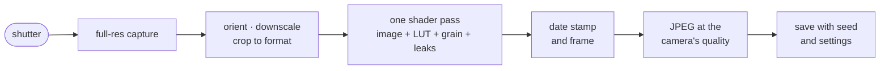

<p align="center">
  
</p>

<p align="center">
  <b>The digicam you never had, in your pocket.</b><br>
  <sub>Harsh flash. CCD colour. Grain. An orange date stamp in the corner. A camera app that shoots like 2003, rendered on the GPU the moment you press the shutter.</sub>
</p>

<p align="center">
  <sub>
    <a href="#overview">OVERVIEW</a> &nbsp;·&nbsp;
    <a href="#quick-start">QUICK START</a> &nbsp;·&nbsp;
    <a href="#the-cameras">THE CAMERAS</a> &nbsp;·&nbsp;
    <a href="#how-a-photo-is-developed">HOW A PHOTO IS DEVELOPED</a> &nbsp;·&nbsp;
    <a href="#how-a-look-is-made">HOW A LOOK IS MADE</a> &nbsp;·&nbsp;
    <a href="#status">STATUS</a>
  </sub>
</p>

<br>

<table>
  <tr>
    <td><sub>PLATFORM</sub><br><b>Android first</b></td>
    <td><sub>STACK</sub><br><b>Flutter + fragment shaders</b></td>
    <td><sub>PHOTO CAMERAS</sub><br><b>5</b></td>
    <td><sub>TAPE LOOKS</sub><br><b>3</b></td>
    <td><sub>ADS</sub><br><b>None. One-time unlock.</b></td>
  </tr>
</table>

## Overview

Most "vintage" camera apps are a filter with a nostalgic name. Shuttr is the opposite approach: five cameras, each modelled on the documented behaviour of a real one, and tuned side by side against real reference photos.

It shoots photos and video, develops them on the GPU, and keeps everything on your phone.

## Quick start

Flutter (stable) and the Android SDK.

```bash
flutter pub get
flutter run
```

See every camera side by side on one synthetic scene:

```bash
SHEET_DIR=/tmp/sheet flutter test test/looks/look_contact_sheet_test.dart
```

## The cameras

| Camera | Modelled on | What gives it away |
|---|---|---|
| **Digi '03** | A 3–5 MP CCD compact | On-axis flash, blown foreheads, a black room. Hard-clipped highlights, cool shadows, pushed reds, over-sharpened halos, an orange seven-segment date. |
| **Disposable** | A single-use film camera | Warmer flash, lifted blacks, soft roll-off, heavy vignette, grain, and a light leak on about one shot in three. |
| **Instant** | An instant film print | Soft and faded, milky blacks, cyan shadows, a white frame with the thick bottom border. |
| **Point & Shoot 35** | A lab-scanned 35mm compact | A gentle S-curve, flattering skin, and red-orange halation around every light. |
| **Cine 800T** | Tungsten cinema negative | A cyan cast in daylight, teal against orange, strong halation, heavy grain. |

**On tape:** VHS (smeared colour, tracking bands, a head-switch tear, 9 kHz mono with hiss), MiniDV (crisp, cool, a timecode), and Digi '03's camcorder mode. Each look changes the sound as well as the picture.

## How a photo is developed



The whole look is a single fragment-shader pass, driven by a `LookSpec`, in the order a real camera would impose it:

| # | Stage | What it models |
|:-:|---|---|
| 1 | Geometry | A 2003 compact does not output 50 megapixels |
| 2 | Flash | A hotspot from the centre, the background falling away |
| 3 | Phone undo | Reverses the phone's HDR, so skies blow out again |
| 4 | Tone | A hard clip for CCD, a soft shoulder for film |
| 5 | Colour | A 3D LUT fitted from real reference shots |
| 6 | Highlights | CCD bloom, or film's red-orange halation |
| 7 | Lens | Vignette, fringing, cheap plastic softness |
| 8 | Sensor or film | Blotchy colour noise, or organic grain |
| 9 | Processing | Over-sharpening, halos and all |
| 10 | Overlays | Light leaks and dust from a stored seed |

> [!TIP]
> The random seed is saved with every photo, so re-developing it reproduces the same leak and the same grain. Your accident stays your accident.

## How a look is made

1. **Reference.** Ten or more scenes on the real camera, or the closest available, and the same scenes on the test phone.
2. **LUT.** Fit a colour LUT from the pairs. Colour only: never grain, flash or sharpness.
3. **Tune** everything else on a debug slider screen, side by side with the reference.
4. **Bake** the values into the camera's spec file, with golden test images.
5. **Blind test.** Can five people tell it from the real thing?
6. **Freeze.** A tuned look only changes with a new golden image and an explicit note.

Every camera's full spec is in [`docs/LOOKS.md`](docs/LOOKS.md). Nine more cameras were built and then cut, because five good ones beat fourteen that blur together.

## Status

Feature-complete for v1 photo and video on a Galaxy S20 FE. The next gate is the blind test. Store release (signing, billing, renaming the placeholder app ID) is parked until it passes.

<details>
<summary><b>Repository layout</b></summary>
<br>

```
lib/features/camera    the camera screen
lib/features/looks     LookSpec, registry, render pipeline, date stamp
lib/features/video     tape looks and the Tapes roll
lib/features/gallery   gallery, viewer, share
lib/features/import    apply a look to an existing photo
lib/features/dump      photo-dump export
shaders/               look.frag, preview.frag
tool/                  LUT fitting, texture and sound generators
test/                  pipeline tests and golden images
```

</details>

<details>
<summary><b>Documents</b></summary>
<br>

[Product](docs/PRODUCT.md) · [Architecture](docs/ARCHITECTURE.md) · [Looks](docs/LOOKS.md) · [Look research](docs/LOOK_RESEARCH.md) · [Decisions](docs/DECISIONS.md) · [Roadmap](docs/ROADMAP.md) · [Progress](docs/PROGRESS.md)

</details>
