# Shuttr UI screenshots

Captured live from `design/camera-directions.html` (current file).

-  — **Camera — Digi '03, cameras closed (default)**
- 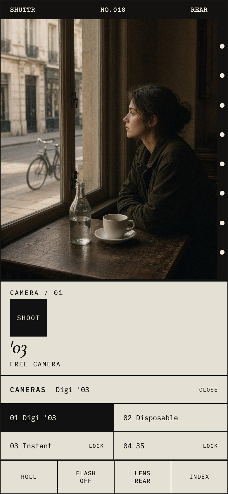 — **Camera — cameras picker open**
- 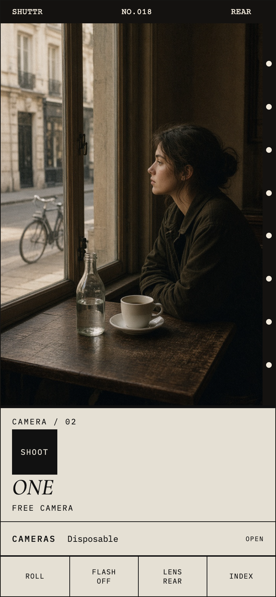 — **Camera — Disposable**
-  — **Camera — Instant (preview only)**
- 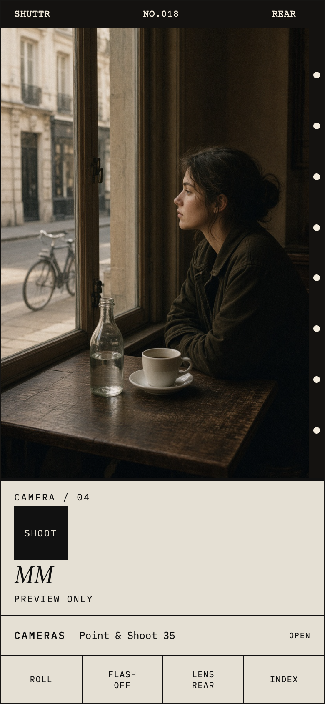 — **Camera — Point & Shoot 35 (preview only)**
-  — **Camera — flash AUTO**
- 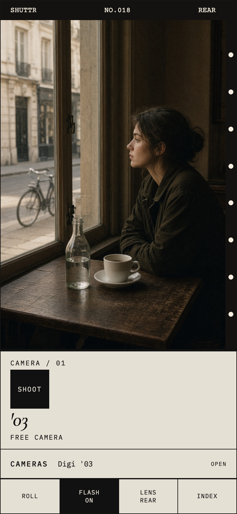 — **Camera — flash ON**
- 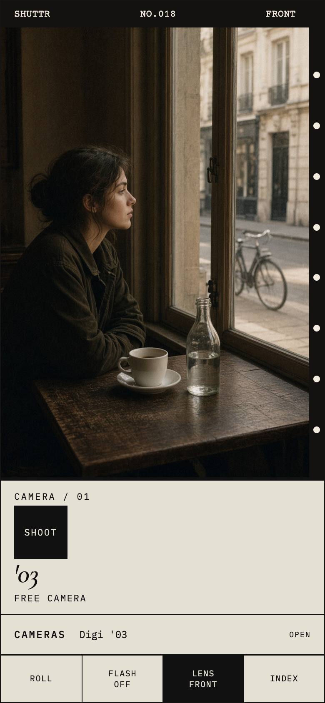 — **Camera — front lens**
- 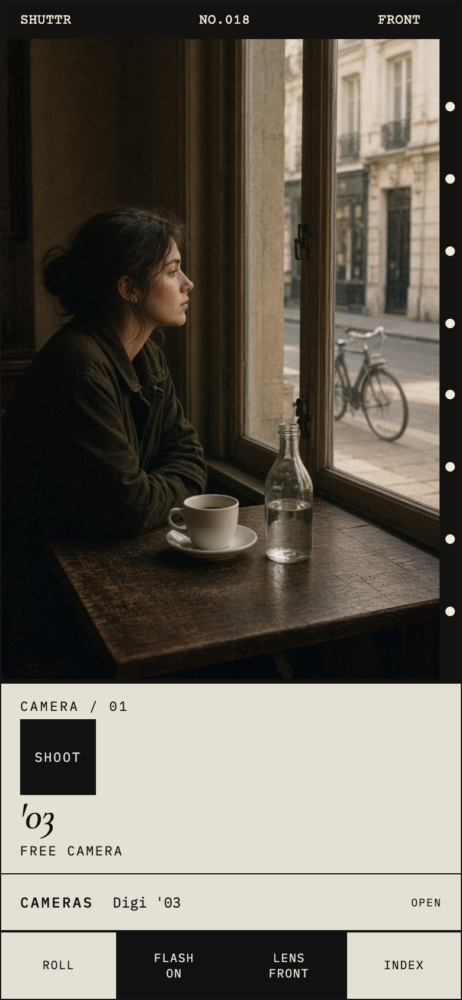 — **Camera — front lens + screen flash ON**
-  — **Camera — date stamp on**
- 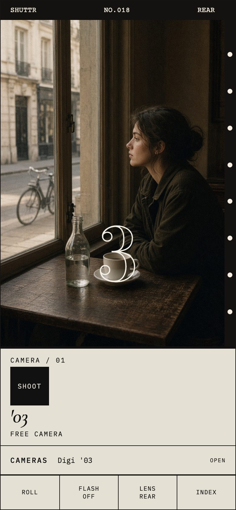 — **Camera — mirror countdown 3**
- 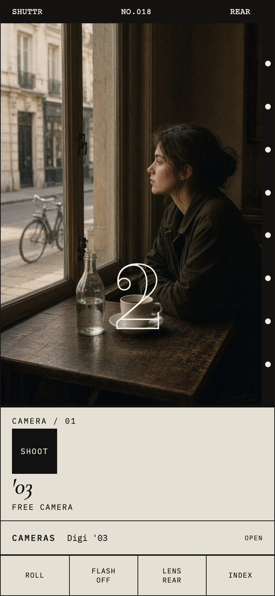 — **Camera — mirror countdown 2**
- 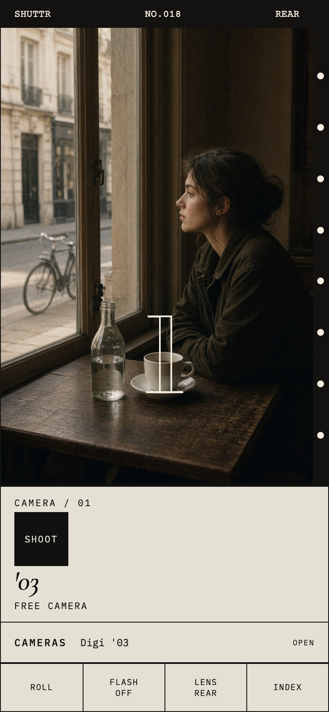 — **Camera — mirror countdown 1**
- 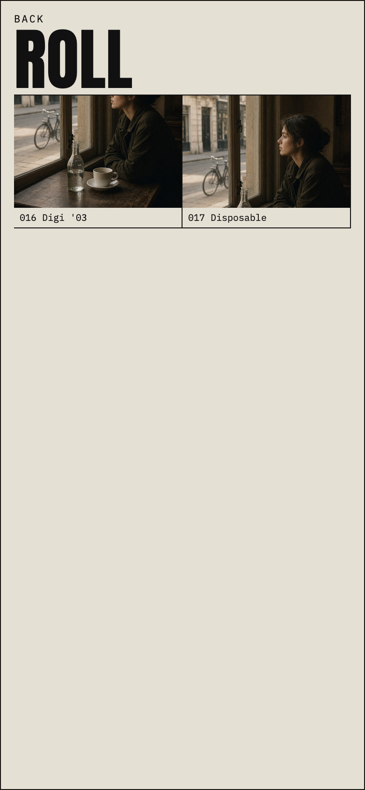 — **Roll — with frames**
- 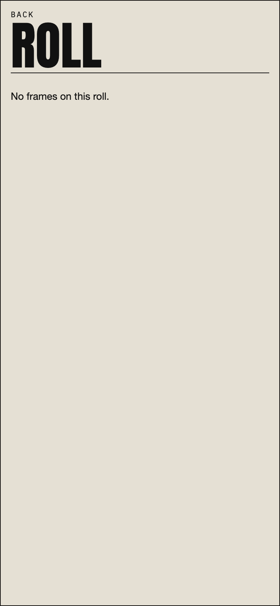 — **Roll — empty**
- 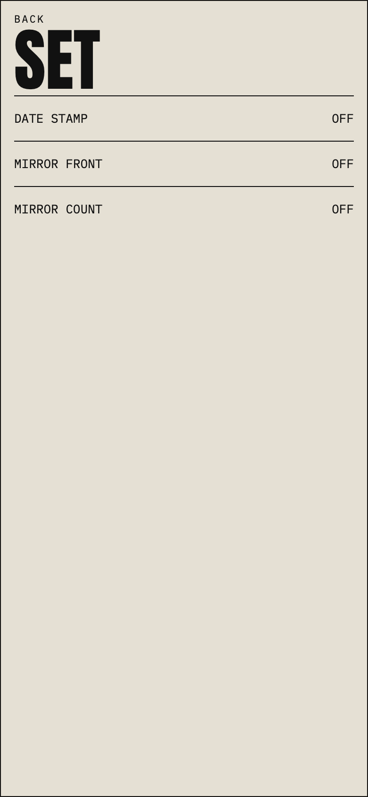 — **Settings — all off**
- 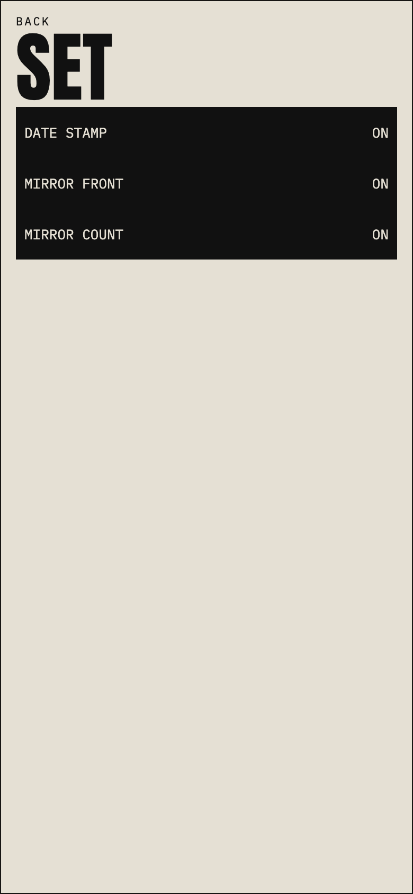 — **Settings — all on**
- 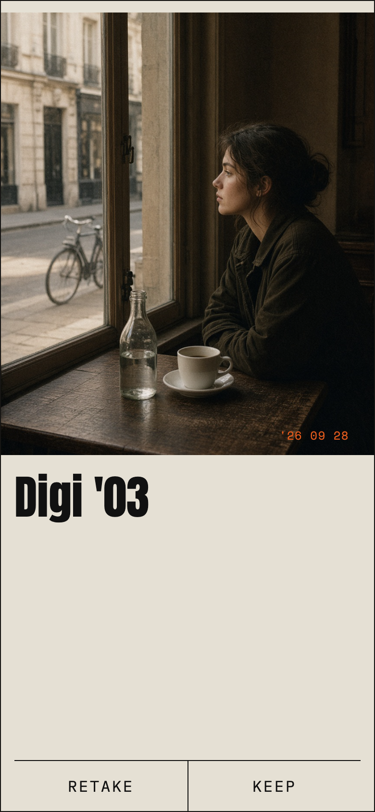 — **Review — RETAKE / KEEP (default seeded shot)**
- 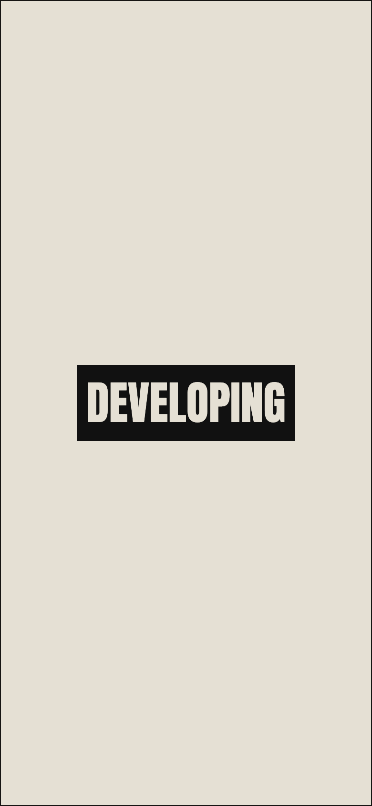 — **Review — developing**
- 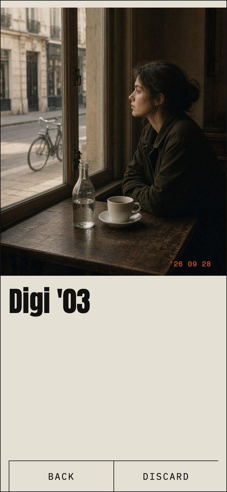 — **Review — from roll (BACK / DISCARD)**
- 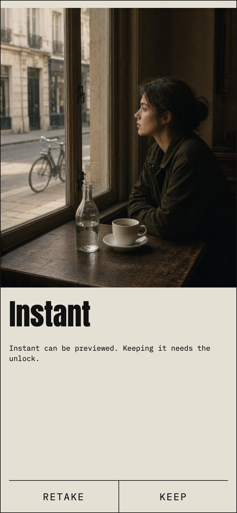 — **Review — Instant locked keep gate**
- 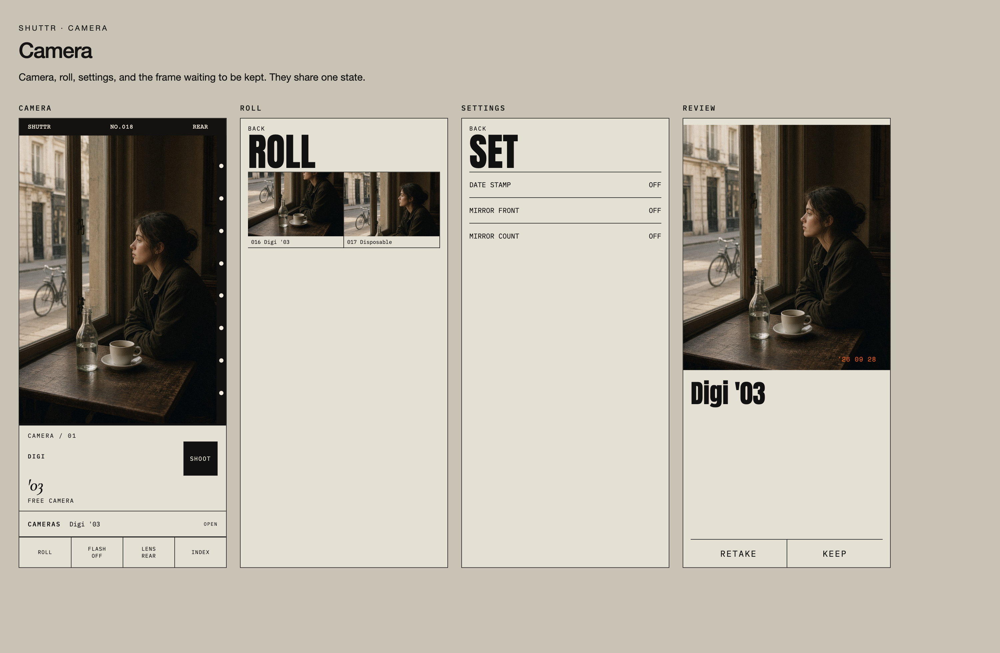 — **Full board — all four pages at default state**
